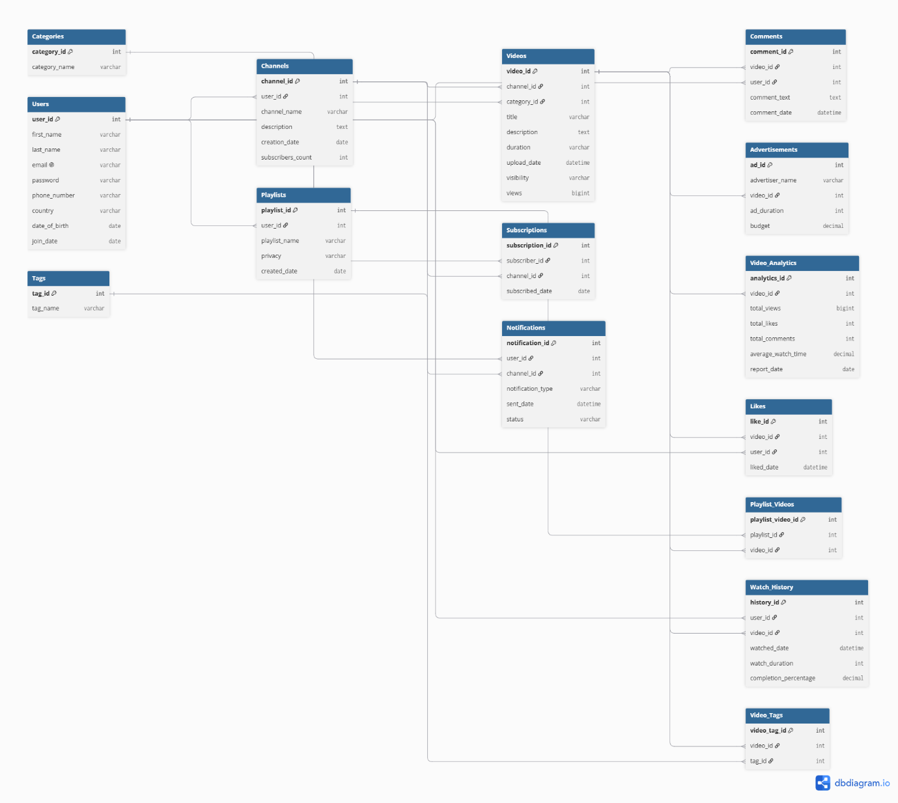

# ▶️ Product Dissection & Database Schema Design: YouTube

**A product case study of YouTube, turned into a relational database schema and ER diagram**

This project dissects YouTube as a product: the real-world problems it solves, the features that solve them, and the **relational database** needed to power those features. The result is a 15-table schema covering users, channels, videos, engagement, playlists, subscriptions, notifications, tags, advertising and analytics, visualised as an Entity-Relationship (ER) diagram.

### 🎥 Video Explanation

A walkthrough of the product dissection, schema and ER diagram:

[](https://drive.google.com/file/d/1wWovdPdrXOTPtjOhh_tNayWDgyNUGzKO/view?usp=sharing)



---

## 📌 Project Objectives

1. Understand how YouTube solves real problems for learners, creators, businesses and viewers.
2. Identify the core product features that make this possible.
3. Translate those features into **entities, attributes and relationships**.
4. Design a normalised relational schema with clear primary and foreign keys.
5. Visualise the design as an ER diagram.

---

## 🛠️ Tools & Concepts

| Area | Details |
|---|---|
| Diagramming | [dbdiagram.io](https://dbdiagram.io) |
| Concepts | Product dissection, ER modelling, relational schema design, normalisation |
| Keys | Primary keys, foreign keys, junction tables for many-to-many relationships |
| Deliverable | Case study document and ER diagram |

---

## 🔍 Part 1: Product Dissection

### Real-world problems YouTube solves

| # | Problem | YouTube's solution | Key features |
|---|---|---|---|
| 1 | **Limited access to quality education:** coaching and courses are expensive | Free lessons from teachers, universities and professionals, organised into self-paced playlists | Educational channels, playlists, search, subtitles, live classes |
| 2 | **Hard to reach a global audience:** traditional marketing is costly | Anyone can start a channel. Search, recommendations and subscriptions grow audiences organically | Channels, upload, search, recommendations, subscriptions |
| 3 | **Information overload:** millions of videos to choose from | AI/ML recommendations based on watch history, searches, likes and subscriptions | Recommendation engine, watch and search history, trending |
| 4 | **Few income opportunities for creators** | The YouTube Partner Program: ads, memberships, Super Chat, Premium revenue and sponsorships | Partner Program, AdSense, memberships, Super Chat |
| 5 | **Fixed TV schedules** | On-demand streaming on any device, with pause and resume | On-demand streaming, watch history, mobile and smart TV apps |
| 6 | **Costly customer engagement for businesses** | Product demos, tutorials, ads and live events, measured with analytics | Business channels, video ads, analytics, live streaming |

### Top features

| Feature | What it enables |
|---|---|
| 👤 User accounts & profiles | Watching, subscribing, playlists, likes, comments and a personalised experience |
| 📺 Channels | Uploading, organising content and building a personal or professional brand |
| ⬆️ Video upload & streaming | Titles, descriptions, thumbnails, captions and tags, with on-demand playback across devices |
| 💬 User interactions | Likes, comments, replies, shares and saving to playlists |
| 🔔 Subscriptions & notifications | Alerts about new uploads, so creators keep their audience |
| 🔎 Search & recommendations | AI-driven discovery based on interests and viewing behaviour |
| 📂 Playlists & watch history | Organising videos and picking up where you left off |
| 🔴 Live streaming & Shorts | Real-time interaction and short-form video |

---

## 🗄️ Part 2: Database Schema

### Entities at a glance

| Table | Purpose | Primary key | Foreign keys |
|---|---|---|---|
| `Users` | Everyone on the platform: viewers and creators | `user_id` | |
| `Channels` | Creator channels owned by users | `channel_id` | `user_id` |
| `Categories` | Video topics (Education, Gaming, Music…) | `category_id` | |
| `Videos` | Uploaded content | `video_id` | `channel_id`, `category_id` |
| `Comments` | User comments on videos | `comment_id` | `video_id`, `user_id` |
| `Likes` | User likes on videos | `like_id` | `video_id`, `user_id` |
| `Subscriptions` | Users following channels | `subscription_id` | `subscriber_id` → Users, `channel_id` |
| `Playlists` | User-created video collections | `playlist_id` | `user_id` |
| `Playlist_Videos` | Which videos are in which playlist | `playlist_video_id` | `playlist_id`, `video_id` |
| `Watch_History` | Every viewing session | `history_id` | `user_id`, `video_id` |
| `Notifications` | Alerts sent to users about channel activity | `notification_id` | `user_id`, `channel_id` |
| `Tags` | Discovery keywords | `tag_id` | |
| `Video_Tags` | Which tags are on which video | `video_tag_id` | `video_id`, `tag_id` |
| `Advertisements` | Ads shown on videos | `ad_id` | `video_id` |
| `Video_Analytics` | Periodic performance reports per video | `analytics_id` | `video_id` |

<details>
<summary><b>📋 Full column list for every table (click to expand)</b></summary>

#### Users
| Column | Type | Notes |
|---|---|---|
| `user_id` | int | **PK** |
| `first_name` | varchar | |
| `last_name` | varchar | |
| `email` | varchar | Registered email address |
| `password` | varchar | Stored encrypted |
| `phone_number` | varchar | |
| `country` | varchar | |
| `date_of_birth` | date | |
| `join_date` | date | Account creation date |

#### Channels
| Column | Type | Notes |
|---|---|---|
| `channel_id` | int | **PK** |
| `user_id` | int | **FK** → Users (owner) |
| `channel_name` | varchar | |
| `description` | text | |
| `creation_date` | date | |
| `subscribers_count` | int | |

#### Categories
| Column | Type | Notes |
|---|---|---|
| `category_id` | int | **PK** |
| `category_name` | varchar | Education, Gaming, Music, Technology… |

#### Videos
| Column | Type | Notes |
|---|---|---|
| `video_id` | int | **PK** |
| `channel_id` | int | **FK** → Channels |
| `category_id` | int | **FK** → Categories |
| `title` | varchar | |
| `description` | text | |
| `duration` | varchar | |
| `upload_date` | datetime | |
| `visibility` | varchar | Public, Private or Unlisted |
| `views` | bigint | |

#### Comments
| Column | Type | Notes |
|---|---|---|
| `comment_id` | int | **PK** |
| `video_id` | int | **FK** → Videos |
| `user_id` | int | **FK** → Users |
| `comment_text` | text | |
| `comment_date` | datetime | |

#### Likes
| Column | Type | Notes |
|---|---|---|
| `like_id` | int | **PK** |
| `video_id` | int | **FK** → Videos |
| `user_id` | int | **FK** → Users |
| `liked_date` | datetime | |

#### Subscriptions
| Column | Type | Notes |
|---|---|---|
| `subscription_id` | int | **PK** |
| `subscriber_id` | int | **FK** → Users |
| `channel_id` | int | **FK** → Channels |
| `subscribed_date` | date | |

#### Playlists
| Column | Type | Notes |
|---|---|---|
| `playlist_id` | int | **PK** |
| `user_id` | int | **FK** → Users (owner) |
| `playlist_name` | varchar | |
| `privacy` | varchar | |
| `created_date` | date | |

#### Playlist_Videos
| Column | Type | Notes |
|---|---|---|
| `playlist_video_id` | int | **PK** |
| `playlist_id` | int | **FK** → Playlists |
| `video_id` | int | **FK** → Videos |

#### Watch_History
| Column | Type | Notes |
|---|---|---|
| `history_id` | int | **PK** |
| `user_id` | int | **FK** → Users |
| `video_id` | int | **FK** → Videos |
| `watched_date` | datetime | |
| `watch_duration` | int | |
| `completion_percentage` | decimal | Share of the video watched |

#### Notifications
| Column | Type | Notes |
|---|---|---|
| `notification_id` | int | **PK** |
| `user_id` | int | **FK** → Users (recipient) |
| `channel_id` | int | **FK** → Channels (source) |
| `notification_type` | varchar | |
| `sent_date` | datetime | |
| `status` | varchar | Read or Unread |

#### Tags
| Column | Type | Notes |
|---|---|---|
| `tag_id` | int | **PK** |
| `tag_name` | varchar | |

#### Video_Tags
| Column | Type | Notes |
|---|---|---|
| `video_tag_id` | int | **PK** |
| `video_id` | int | **FK** → Videos |
| `tag_id` | int | **FK** → Tags |

#### Advertisements
| Column | Type | Notes |
|---|---|---|
| `ad_id` | int | **PK** |
| `advertiser_name` | varchar | |
| `video_id` | int | **FK** → Videos |
| `ad_duration` | int | |
| `budget` | decimal | |

#### Video_Analytics
| Column | Type | Notes |
|---|---|---|
| `analytics_id` | int | **PK** |
| `video_id` | int | **FK** → Videos |
| `total_views` | bigint | |
| `total_likes` | int | |
| `total_comments` | int | |
| `average_watch_time` | decimal | |
| `report_date` | date | |

</details>

### Relationships

| Relationship | Cardinality | Implemented through |
|---|---|---|
| Users **create** Channels | One-to-many | `Channels.user_id` |
| Channels **upload** Videos | One-to-many | `Videos.channel_id` |
| Categories **group** Videos | One-to-many | `Videos.category_id` |
| Users **comment on** Videos | Many-to-many | `Comments` |
| Users **like** Videos | Many-to-many | `Likes` |
| Users **subscribe to** Channels | Many-to-many | `Subscriptions` |
| Users **create** Playlists | One-to-many | `Playlists.user_id` |
| Playlists **contain** Videos | Many-to-many | `Playlist_Videos` |
| Users **watch** Videos | Many-to-many | `Watch_History` |
| Channels **send** Notifications to Users | One-to-many (each side) | `Notifications` |
| Videos **have** Tags | Many-to-many | `Video_Tags` |
| Videos **display** Advertisements | One-to-many | `Advertisements.video_id` |
| Videos **have** analytics reports | One-to-many | `Video_Analytics.video_id` |

### Design highlights

- **Junction tables for every many-to-many relationship** (`Playlist_Videos`, `Video_Tags`, `Likes`, `Subscriptions`, `Watch_History`, `Comments`), so no table stores repeated lists of IDs.
- **Interactions carry their own timestamps** (`liked_date`, `subscribed_date`, `watched_date`, `comment_date`), which is the raw material for recommendations and trend analysis.
- **Watch behaviour is captured in detail** (`watch_duration`, `completion_percentage`), not just view counts. This is the kind of signal a recommendation engine depends on.
- **Analytics live in their own table**, so periodic performance snapshots don't bloat the core `Videos` table.
- **Monetisation is modelled explicitly** through `Advertisements`, linking ad budgets to the videos that display them.

---

## ✅ Conclusion

YouTube's features (personalised recommendations, creator monetisation, subscriptions, playlists and analytics) all rest on a well-structured relational database. This project shows how a product's features can be translated into a normalised schema that keeps data consistent, avoids redundancy and scales with engagement.

---

## 📁 Repository Structure

```text
├── Product Dissection for YouTube.docx   # Full case study
├── images/
│   └── er_diagram.png                    # ER diagram
└── README.md
```

---

## 👤 Author

**Chetna Maurya**

[](https://www.linkedin.com/in/chetna-maurya-56a542431/)
